<!-- Designed and hand-built by Chunduri Sai Kaushik. Assets in /assets are generated SVGs. -->

  
  
  
  
  

 

  

  

  
  

  
  

<b>More builds</b>

 

| Project | What it does |
| --- | --- |
| [Agentic AI DevOps Assistant](https://github.com/Kaushik-verse/Agentic-AI-DevOps-Assistant) | Multi-agent incident management with LangGraph, RAG and root-cause analysis |
| [Speed Bump Detection](https://github.com/Kaushik-verse/-Speed-bump-detection-v1) | Real-time YOLOv8 speed-bump detection for driver assistance |
| [Fullstack POS](https://github.com/Kaushik-verse/Fullstack-pos-system) | React + Spring Boot + MySQL point-of-sale with inventory and analytics |
| [GreenLens](https://github.com/Kaushik-verse/GreenLens) | AI waste classification with disposal guidance |

 

  

**✍️ Writing** &nbsp;·&nbsp; [The Day Human Mistakes Became Luxury Goods](https://medium.com/@chundurisaikaushik/the-day-human-mistakes-became-luxury-goods-d65fcf31033a) &nbsp;·&nbsp; [The 2% Rule: Why We Trust AI Advice But Reject AI Decisions](https://medium.com/@chundurisaikaushik/the-2-rule-why-we-trust-ai-advice-but-reject-ai-decisions-eb5e6d6acb60)

 

<picture>
  <source media="(prefers-color-scheme: dark)" srcset="https://raw.githubusercontent.com/Kaushik-verse/Kaushik-verse/output/snake-dark.svg">
  <source media="(prefers-color-scheme: light)" srcset="https://raw.githubusercontent.com/Kaushik-verse/Kaushik-verse/output/snake-light.svg">
  
</picture>

  

© 2026 Chunduri Sai Kaushik. Artwork and copy in this profile are not licensed for reuse.
